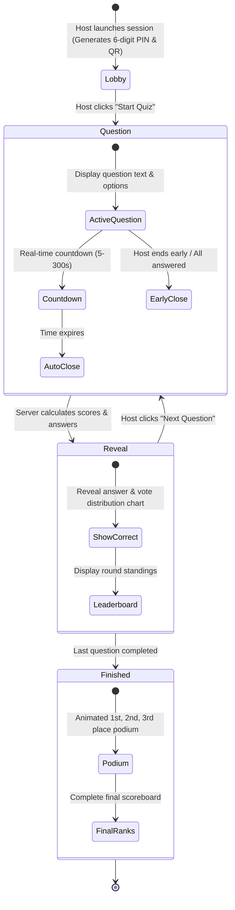

# Otázky Free – Live Interactive Quiz Platform

[](https://nextjs.org/)
[](https://www.typescriptlang.org/)
[](https://tailwindcss.com/)
[](https://supabase.com/)
[](https://vitest.dev/)
[](https://biomejs.dev/)

A modern, high-performance, real-time multiplayer quiz platform built for parties, team events, conferences, and classrooms. Inspired by Kahoot, it allows a host to project a live game session onto a large display or projector while participants join effortlessly from mobile devices using a 6-digit PIN or QR code.

The application is completely stateless, serverless, and optimized for zero-maintenance deployments on **Vercel** with **Supabase (PostgreSQL + Realtime)** as the real-time data layer.

---

## 🌟 Key Features

### 🖥️ Host & Presentation Dashboard
- **Big-Screen Projector View**: Dedicated live stage optimized for TVs, projectors, and large displays.
- **Dynamic Join Screen**: Automatically renders a high-contrast QR code and 6-digit game PIN with real-time participant roster updates as players join.
- **Host Live Controls**: Pacing controls to advance questions, countdown monitors, live submission counters (*e.g., "18 / 24 players answered"*), and manual early question closure.
- **Real-Time Visualizations**: Interactive response breakdown bar charts and dynamic leaderboards between rounds.
- **Winner Podium**: Olympic-style animated podium celebration (1st, 2nd, and 3rd place) with celebratory confetti canvas animations.

### 📱 Mobile-First Player Experience
- **Zero Friction Onboarding**: Instant entry via mobile browser—no downloads, account registrations, or app installations required.
- **Synchronized Live State**: Question options, color-coded tactile buttons, synchronized countdown timers, and immediate answer confirmations.
- **Instant Result Cards**: Clear visual feedback (correct/incorrect status, current rank, and points earned) revealed synchronously across all devices.
- **Sleep & Disconnect Resilience**: Player sessions and credentials persist in `localStorage`, enabling seamless recovery upon page reload, screen wake, or transient network interruptions.

### 🛡️ Enterprise Security & Anti-Cheat Architecture
- **Server-Authoritative Evaluation**: Game state transitions, timer enforcement, and score calculations are executed exclusively on server route handlers.
- **Zero Answer Leakage**: Quiz questions and choices are streamed to players without the `correct_index` payload until the question officially closes and enters the reveal phase.
- **Row-Level Security (RLS)**: Public clients operate strictly under anonymous permissions, restricted from directly reading questions or answer keys from PostgreSQL.
- **Input Sanitization & Protection**: Strict UUID validation, payload size caps (64 KB limit), uniqueness constraints on player nicknames per session, and timing leeway against network jitter.

### 📝 Quiz Management Suite
- **Interactive Quiz Builder**: Web-based administration interface (`/admin`) for creating, editing, and managing quizzes.
- **Configurable Questions**: Support for 2 to 4 multiple-choice options, custom question text, and per-question timers (5 to 300 seconds).
- **Validation Guard**: Prevents launching sessions with missing answer keys or duplicate answer choices.

---

## 🏗️ Architecture & Data Flow

```
┌─────────────────────────────────┐       ┌─────────────────────────────────┐
│     Player Mobile Device        │       │       Host Display / TV         │
│  (Next.js Client / Touch UI)    │       │     (Next.js Host Dashboard)    │
└────────────────┬────────────────┘       └────────────────┬────────────────┘
                 │                                         │
                 │   HTTP Actions (Join, Answer, Poll)     │   Admin Controls
                 ▼                                         ▼
┌───────────────────────────────────────────────────────────────────────────┐
│                 Next.js 16 App Router (Serverless / Vercel)               │
│                                                                           │
│   • Server Route Handlers (/api/game/*, /api/admin/*)                     │
│   • Server-Authoritative Game Loop & Speed Scoring Logic                  │
│   • Password-Protected Admin Auth & Secure Cookie Session                 │
└─────────────────────────────────────┬─────────────────────────────────────┘
                                      │
               Internal API           │ SUPABASE_SERVICE_ROLE_KEY
             (Privileged Data)        ▼
┌───────────────────────────────────────────────────────────────────────────┐
│                           Supabase Platform                               │
│                                                                           │
│   ┌────────────────────────────────┐    ┌─────────────────────────────┐   │
│   │     PostgreSQL Database        │    │      Supabase Realtime      │   │
│   │  • quizzes, questions          │◄───┤    (WebSocket broadcast)    │   │
│   │  • game_sessions, players      │    │  • Session status change    │   │
│   │  • answers, RLS Policies       │    │  • Player roster updates    │   │
│   └────────────────────────────────┘    └─────────────────────────────┘   │
└───────────────────────────────────────────────────────────────────────────┘
```

### Real-Time & Fallback Strategy
1. **Primary Transport**: Supabase Realtime broadcasts table row changes (`game_sessions`, `players`) via WebSockets to connected browsers.
2. **Metadata Protection**: Clients never receive raw answer tables directly through Realtime. Instead, Realtime signals state changes, prompting clients to fetch sanitized state from `/api/game/...`.
3. **Automatic Fallback Polling**: If WebSocket connectivity drops or is blocked by restrictive corporate/venue networks, automatic background polling engages (6-second intervals for players, 4-second intervals for the host).
4. **Dead-Host Fail-Safe**: If a host machine goes to sleep or disconnects during an active question, the server automatically resolves and closes the question once its expiration deadline passes.

---

## 🔄 Game Lifecycle



---

## ⚡ Scoring Engine

The scoring system rewards both **accuracy** and **speed**, calculated deterministically on the server:

| Condition | Points Awarded |
| :--- | :--- |
| **Incorrect Answer** | `0` points |
| **No Answer / Time Out** | `0` points |
| **Correct Answer (Base)** | `500` points |
| **Speed Bonus** | Up to `+500` points based on remaining time fraction |
| **Total Possible per Question** | **~1,000 points** |

$$\text{Points} = \text{round}\left(500 + 500 \times \max\left(0, \frac{\text{Time Remaining}}{\text{Total Question Time Limit}}\right)\right)$$

> **Security Note**: Scores are awarded only when the question reaches the `reveal` stage. Scores remain hidden during the active question phase so players cannot infer correctness before the round finishes. In the event of a point tie, earlier game join timestamp breaks the tie.

---

## 🗄️ Database Schema & Row-Level Security (RLS)

The database schema utilizes PostgreSQL with strict relational integrity, check constraints, and Row Level Security:

### Table Overview

| Table | Purpose | Public Access (`anon`) | Server Access (`service_role`) |
| :--- | :--- | :---: | :---: |
| `quizzes` | Quiz metadata and configurations | 🚫 Blocked | Full access |
| `questions` | Question prompts, options, limits, and `correct_index` | 🚫 Blocked | Full access |
| `game_sessions` | Active session state, current index, PIN, timer timestamps | Read-only | Full access |
| `players` | Registered players, nicknames, session links, total scores | Read-only | Full access |
| `answers` | Recorded player responses, timestamps, and awarded points | 🚫 Blocked | Full access |

---

## 🧰 Tech Stack

- **Framework**: [Next.js 16 (App Router)](https://nextjs.org/)
- **Language**: [TypeScript 5](https://www.typescriptlang.org/)
- **Styling**: [Tailwind CSS v4](https://tailwindcss.com/) with `@tailwindcss/turbopack`
- **UI Components**: [Radix UI](https://www.radix-ui.com/) primitives styled following [shadcn/ui](https://ui.shadcn.com/) patterns
- **Database & Realtime**: [Supabase](https://supabase.com/) (PostgreSQL, Realtime replication, RLS)
- **Visuals & Effects**: `canvas-confetti`, `lucide-react`, `qrcode.react`
- **Testing**: [Vitest](https://vitest.dev/) with comprehensive in-memory database simulation
- **Code Quality**: [Biome](https://biomejs.dev/) (fast formatting and linting)

---

## 📂 Project Structure

```
otazky-free/
├── src/
│   ├── app/
│   │   ├── page.tsx                     # Player landing screen (PIN entry)
│   │   ├── play/[pin]/                  # Mobile player gameplay interface
│   │   ├── admin/
│   │   │   ├── page.tsx                 # Host portal: quiz list & active games
│   │   │   ├── quizzes/[quizId]/        # Quiz builder and question editor
│   │   │   └── play/[sessionId]/        # Live host control stage & projector view
│   │   └── api/
│   │       ├── game/                    # Public player endpoints (join, answer, state)
│   │       └── admin/                   # Privileged endpoints (auth, quiz CRUD, game loop)
│   ├── components/
│   │   ├── ui/                          # Radix / shadcn/ui design primitives
│   │   └── game/                        # Timer dials, vote charts, leaderboards, podium
│   ├── hooks/                           # Realtime subscriptions and countdown timers
│   ├── lib/                             # Shared utilities, scoring formulas, Supabase clients
│   ├── server/                          # Server-side business logic, validation, queries
│   └── test/                            # In-memory mock database & schema tests
├── supabase/
│   ├── migrations/
│   │   └── 0001_init.sql                # Production database schema, RLS, & triggers
│   └── seed.sql                         # Demo quiz dataset
├── biome.json                           # Linter and formatter configuration
├── components.json                      # shadcn/ui configuration
├── next.config.ts                       # Next.js configuration
├── package.json                         # Project dependencies and run scripts
├── tsconfig.json                        # TypeScript configuration
└── vitest.config.mts                    # Vitest test suite configuration
```

---

## ⚙️ Environment Variables

Create a `.env.local` file in the project root based on `.env.example`:

```bash
cp .env.example .env.local
```

| Variable | Scope | Description |
| :--- | :--- | :--- |
| `NEXT_PUBLIC_SUPABASE_URL` | Public / Browser | Supabase project URL (`https://<project-id>.supabase.co`) |
| `NEXT_PUBLIC_SUPABASE_ANON_KEY` | Public / Browser | Supabase anonymous public key (used for Realtime events) |
| `SUPABASE_SERVICE_ROLE_KEY` | Server Only | **Confidential.** Supabase service role key for privileged queries |
| `ADMIN_PASSWORD` | Server Only | Master secret password used to authenticate to `/admin` |

> ⚠️ **Security Warning**: Never prefix `SUPABASE_SERVICE_ROLE_KEY` with `NEXT_PUBLIC_` or commit it to version control. It bypasses PostgreSQL Row-Level Security and is strictly intended for server-side route execution.

---

## 🚀 Getting Started

### Prerequisites
- **Node.js**: `20.x` or later
- **Package Manager**: `pnpm` (version 9 or 10 recommended)
- **Supabase Account**: A free Supabase project with PostgreSQL and Realtime enabled

### 1. Installation

Clone the repository and install dependencies:

```bash
git clone https://github.com/your-username/otazky-free.git
cd otazky-free
pnpm install
```

### 2. Database Setup

1. In your Supabase dashboard, navigate to **SQL Editor** → **New Query**.
2. Run the initialization script from [`supabase/migrations/0001_init.sql`](supabase/migrations/0001_init.sql). This configures the schema, check constraints, RLS policies, indexes, and Realtime publications.
3. *(Optional)* Run [`supabase/seed.sql`](supabase/seed.sql) to populate a ready-to-play sample quiz.

### 3. Environment Configuration

Populate `.env.local` with your Supabase credentials and an admin password:

```env
NEXT_PUBLIC_SUPABASE_URL=https://your-project-id.supabase.co
NEXT_PUBLIC_SUPABASE_ANON_KEY=your-anon-key
SUPABASE_SERVICE_ROLE_KEY=your-service-role-key
ADMIN_PASSWORD=your-secure-admin-password
```

### 4. Running the Development Server

Start the local Next.js development server:

```bash
pnpm dev
```

- **Player Interface**: Open [http://localhost:3000](http://localhost:3000)
- **Admin & Host Stage**: Open [http://localhost:3000/admin](http://localhost:3000/admin)

> 💡 **Tip for Local Mobile Testing**: When running locally, connect your mobile device to the same local Wi-Fi and open the host dashboard using your LAN IP (e.g. `http://192.168.1.50:3000/admin`). The dynamic QR code will automatically encode your network address for mobile scanning.

---

## 🧪 Testing & Code Quality

The project features a high-coverage unit and integration test suite utilizing [Vitest](https://vitest.dev/). Tests execute without any external database dependencies by leveraging an in-memory SQL simulator that enforces table constraints, unique keys, and triggers.

```bash
# Run test suite once
pnpm test

# Run tests in interactive watch mode
pnpm test:watch

# Run code linter
pnpm lint

# Format codebase
pnpm format
```

### Test Suite Coverage
- **Scoring Formulas**: Precision speed bonus, zero scores on invalid answers, network timestamp tolerance.
- **Game State Machine**: Strict phase progression (`lobby` → `question` → `reveal` → `finished`).
- **Answer Secrecy**: Verification that active question payloads never expose answer indexes.
- **Race Condition Prevention**: Double-submission prevention, duplicate nickname handling, and payload boundary checks.
- **API Guarding**: HTTP 401 unauthorized assertions on all privileged admin endpoints.

---

## 🚢 Production Deployment (Vercel)

1. Push your repository to GitHub, GitLab, or Bitbucket.
2. Import the project into [Vercel](https://vercel.com). The Next.js framework preset is detected automatically.
3. Add the required environment variables in the Vercel project settings:
   - `NEXT_PUBLIC_SUPABASE_URL`
   - `NEXT_PUBLIC_SUPABASE_ANON_KEY`
   - `SUPABASE_SERVICE_ROLE_KEY`
   - `ADMIN_PASSWORD`
4. Click **Deploy**.
5. Once deployed, navigate to `https://your-domain.vercel.app/admin`, log in, and launch your live session.

---

## 📄 License

This project is open-source and available under the [MIT License](LICENSE).
